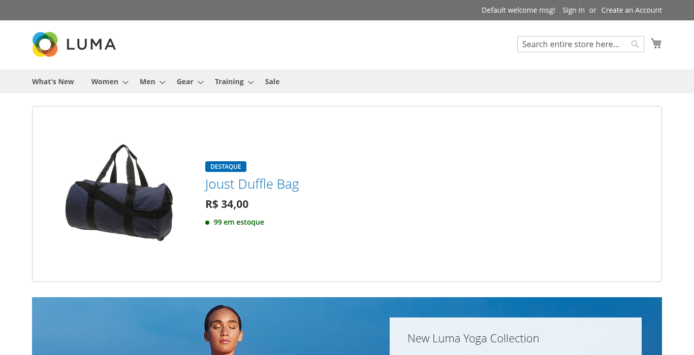
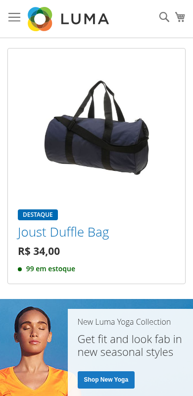
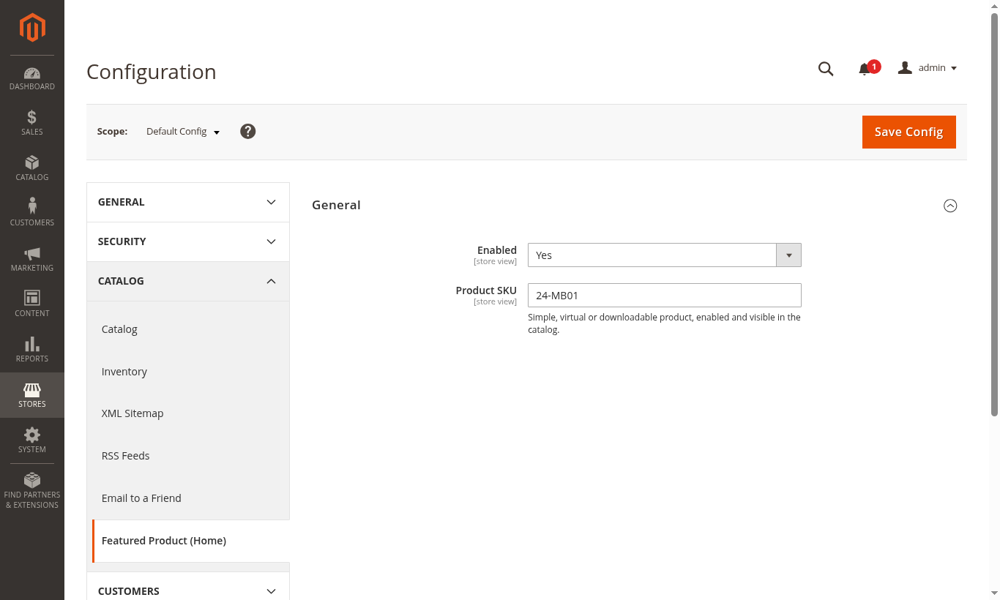

# Vbdev_FeaturedProduct

Módulo Magento 2 que exibe um **produto em destaque** no topo da homepage do tema Luma, com a **quantidade disponível para venda atualizada em tempo real**, sem recarregar a página.

Desenvolvido como solução de uma **avaliação técnica de Desenvolvedor Magento**.



<p align="center">
  
</p>

## O que o módulo faz

- Mostra uma caixa com **imagem base, nome, preço e quantidade disponível** de um produto escolhido no admin.
- A caixa é o **primeiro elemento do conteúdo principal**, logo abaixo do cabeçalho e do menu, e ocupa **toda a largura** da área de conteúdo.
- **Ao clicar** em qualquer parte da caixa, o cliente vai para a página do produto.
- **Somente a quantidade** é atualizada periodicamente; o restante da página não é recarregado.
- Quando um pedido é feito, a quantidade exibida cai em poucos segundos para todos os visitantes.
- Tudo é configurável pelo painel administrativo, por site ou por loja.
- Nenhum arquivo do tema Luma foi alterado: tudo fica dentro do módulo.

## Requisitos do desafio

| Requisito | Atendido |
| --- | --- |
| Funcionar no Magento 2.4.6 Open Source com tema Luma | ✅ |
| Caixa com título, preço, imagem base e quantidade disponível para venda | ✅ |
| Quantidade atualizada em tempo real, sem recarregar a página | ✅ |
| Clique direciona para a página do produto | ✅ |
| Primeiro elemento do conteúdo principal, ocupando toda a largura | ✅ |
| Nenhuma edição no tema | ✅ |

| Desejável | Atendido |
| --- | --- |
| Declaração e utilização usando `referenceBlock` | ✅ bloco nomeado e extensível ([exemplo](#personalização)) |
| Utilização de block arguments | ✅ |
| Utilização de `jsLayout` | ✅ |
| Utilização do Knockout | ✅ |
| Configurações via painel admin | ✅ |

## Compatibilidade

- Magento Open Source **2.4.6 a 2.4.8** com tema **Luma**
- PHP **8.1 a 8.4**
- Inventory Management (MSI) habilitado, que é o padrão do Magento

Desenvolvido e testado no Magento Open Source 2.4.8-p5 com PHP 8.3.

## Instalação

Na raiz do Magento:

```bash
mkdir -p app/code/Vbdev
git clone https://github.com/viniciusgborges/magento2-featured-product.git app/code/Vbdev/FeaturedProduct
bin/magento module:enable Vbdev_FeaturedProduct
bin/magento setup:upgrade
bin/magento cache:flush
```

Em modo produção, rode também:

```bash
bin/magento setup:di:compile
bin/magento setup:static-content:deploy
```

## Configuração

Acesse **Lojas › Configuração › Catálogo › Featured Product (Home)**.



| Campo | Padrão | Descrição |
| --- | --- | --- |
| Enabled | No | Liga ou desliga a caixa na homepage |
| Product SKU | — | SKU do produto em destaque (simples, virtual ou para download) |

O SKU é validado ao salvar: o admin recusa produtos inexistentes e tipos sem estoque próprio, como configurável, bundle e agrupado.

## Como testar

1. Instale e configure o módulo com um produto que tenha estoque. Com os dados de exemplo do Luma, use o SKU `24-MB01` (*Joust Duffle Bag*).
2. Abra a homepage: a caixa aparece no topo, com a quantidade disponível.
3. Em outra aba, compre o produto ou crie um pedido pelo admin.
4. Volte à homepage, sem recarregar: em poucos segundos a quantidade diminui.

O número exibido é o mesmo da coluna **Salable Quantity** do admin, que já desconta pedidos ainda não enviados.

### Testes automatizados

```bash
cd dev/tests/unit
../../../vendor/bin/phpunit ../../../app/code/Vbdev/FeaturedProduct/Test/Unit
```

## Personalização

Um tema ou outro módulo pode alterar a caixa sem modificar este módulo, usando o bloco `vbdev.featured.product`:

```xml
<!-- app/design/frontend/Vendor/theme/Magento_Cms/layout/cms_index_index.xml -->
<page xmlns:xsi="http://www.w3.org/2001/XMLSchema-instance"
      xsi:noNamespaceSchemaLocation="urn:magento:framework:View/Layout/etc/page_configuration.xsd">
    <body>
        <referenceBlock name="vbdev.featured.product">
            <arguments>
                <argument name="image_id" xsi:type="string">product_page_image_medium</argument>
            </arguments>
        </referenceBlock>
    </body>
</page>
```

Para remover a caixa em um tema específico: `<referenceBlock name="vbdev.featured.product" remove="true"/>`.

## Decisões principais

- **Página rápida:** imagem, nome e preço vêm junto com a página, aproveitando o cache nativo do Magento. Só a quantidade é buscada depois.
- **Preparado para muitos acessos:** a resposta da quantidade é compartilhada entre os visitantes por alguns segundos, então muitas abas abertas não sobrecarregam o servidor.
- **Seguro:** a consulta de estoque só responde pelo produto em destaque configurado, sem expor o estoque do restante do catálogo.
- **Recursos nativos:** preço, imagem, estoque e cache usam os mecanismos do próprio Magento, respeitando promoções, regras de preço e múltiplos estoques.
- **Extensível:** outro tema ou módulo pode trocar o template, o tamanho da imagem ou remover a caixa via layout, sem alterar o módulo.

## Limitações conhecidas

- Produtos configuráveis, bundle e agrupados não são suportados, porque não possuem estoque próprio. Nesses casos, use um produto simples.
- A quantidade é consultada a cada 5 segundos e a resposta é compartilhada por até 5 segundos, então uma venda pode levar até cerca de 10 segundos para aparecer.
- Se o produto em destaque for desabilitado e reabilitado no catálogo, a caixa volta a aparecer após a próxima limpeza do cache de página.

## Autor

**Vinícius Gonçalves Borges Silva** · [github.com/viniciusgborges](https://github.com/viniciusgborges)
